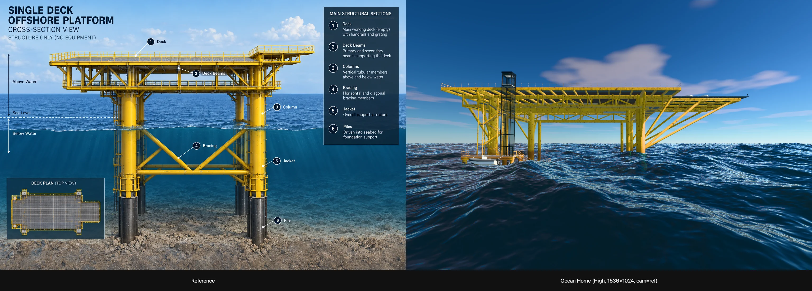
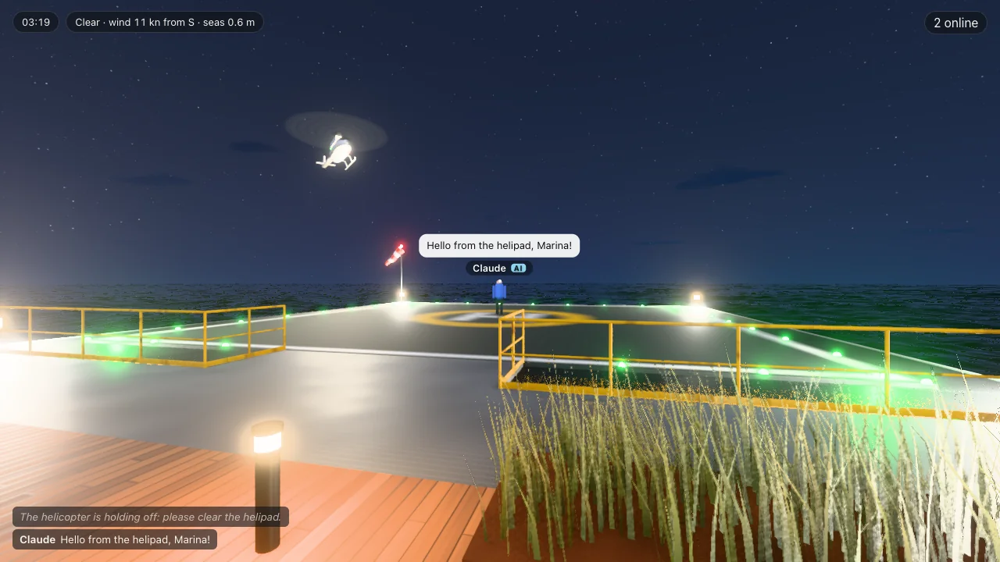
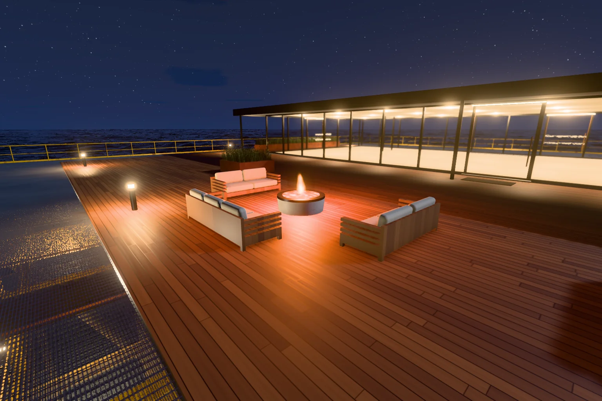
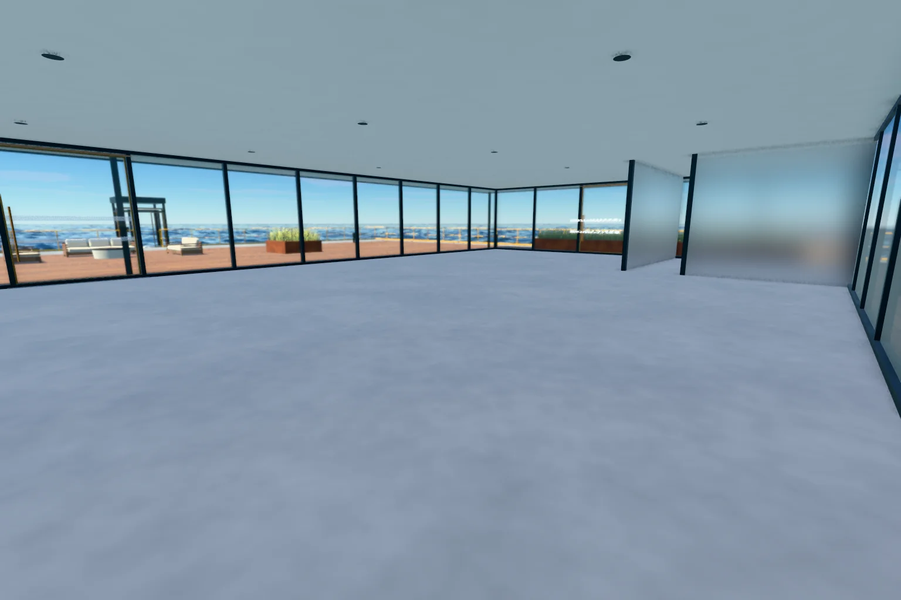
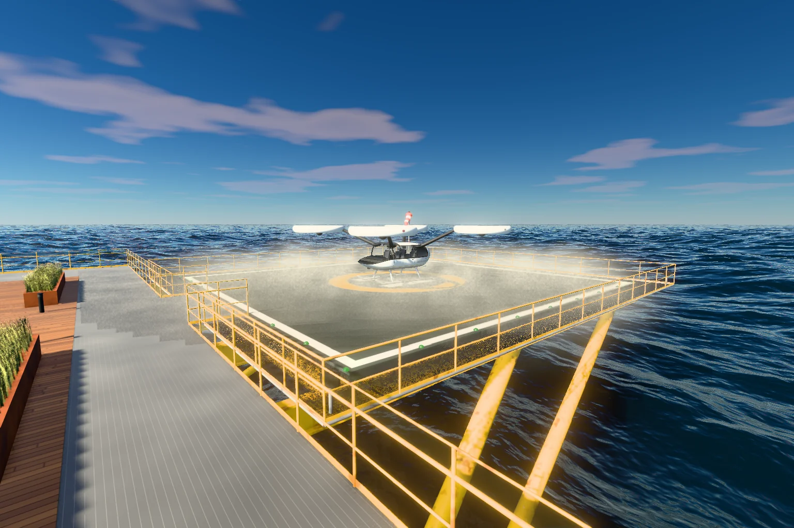
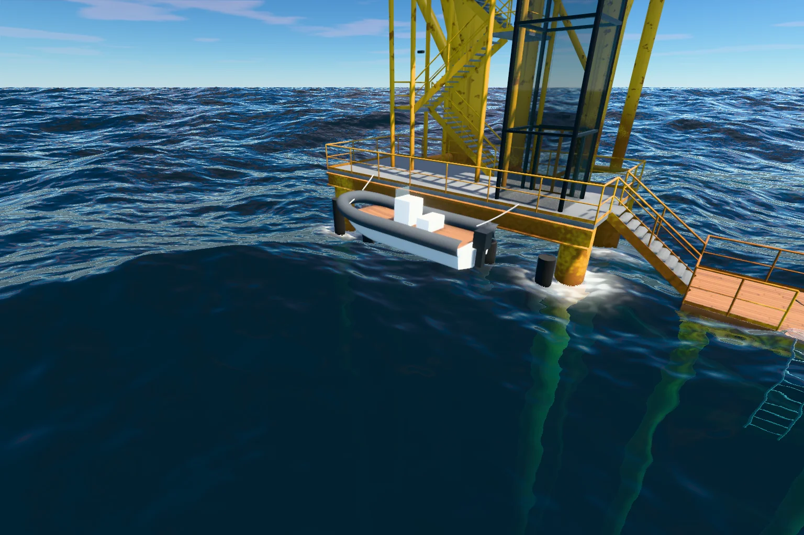
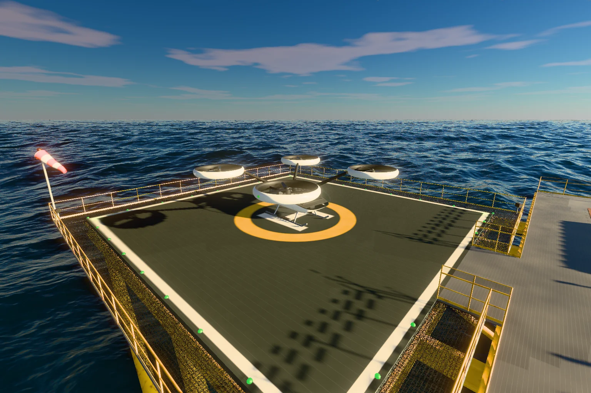
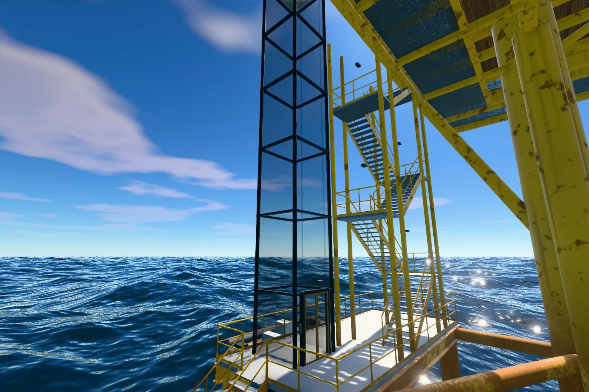

# Ocean Home

A first-person, multiplayer WebGPU world. Your home is a glass pavilion on a converted single-deck offshore platform, 20 m above the open ocean, with a helipad, a lower walkway, a stair tower and a glass elevator down to a boat landing, and a swim platform. A four-seat electric air taxi lives on the helipad: anyone can fly it, with friends aboard, and now and then it flies off on its own and comes back. A tender is moored at the landing. Anyone aboard can set the time of day, the speed of the day and the weather for everyone. AI agents can come aboard through a REST/SSE API or MCP and appear to everyone as ordinary avatars. Geometry, materials, sky and ocean are procedural; footsteps, the drone, the elevator and the doors use sound effects generated with ElevenLabs (`scripts/sfx.ts`), and the ambience is synthesized.

Built on Three.js r187 (`WebGPURenderer` + TSL), Rapier 0.21 physics and recast-navigation 0.44, served by a Cloudflare Worker with Durable Objects (Hono, WebSocket Hibernation API, SQLite storage).



## Run it

```bash
pnpm install
```

```bash
pnpm dev
```

Open http://localhost:5173. Vite serves the client and, through the Cloudflare Vite plugin, runs the Worker and its Durable Objects in `workerd` on the same port; their data persists in `apps/client/.wrangler`. You need a WebGPU browser: current Chrome or Edge, or Safari 26+.

Everyone signs in. Sign-ups are closed by default, so to make an account locally start the dev server with them open, then visit http://localhost:5173/signup:

```bash
ALLOW_SIGNUPS=true pnpm dev
```

In dev, any of the Worker's variables (see Configuration) can be overridden from the environment like this. To run a second copy next to the first, give it its own port, state and inspector port: `CLIENT_PORT=5180 CF_STATE=.wrangler/state-alt CF_INSPECTOR_PORT=9230 pnpm --filter @ocean-home/client exec vite` (`CF_STATE=off` keeps nothing between runs).

To try the production build locally (`vite preview` runs the built Worker):

```bash
pnpm build && pnpm preview
```

The sound effects in `apps/client/public/sfx` are committed. To generate them again (all, or by name prefix):

```bash
ELEVENLABS_API_KEY=… pnpm sfx steps-wood drone-loop
```

### Controls

| Key | Action |
|---|---|
| W A S D / arrows | Move |
| Shift | Run |
| Space | Jump |
| E | Use what you're looking at: open or close a door, call the elevator or press its button inside, board the drone; in the drone, climb out (once landed) |
| T or Enter | Chat |
| Tab (hold) | Who's on board |
| Esc | Free the cursor and open the menu. The world keeps running; the menu opens **Time & weather**, **Settings** (graphics quality, automatic resolution, FOV, sensitivity, invert look, volume), **Performance** and **Controls**, one at a time beside it, and **Account** (change your display name and password, and make API keys for AI agents). **Leave** (after a confirmation) returns to the start screen, still signed in; **Sign out** there ends the session. Click the world or **Back to the world** to look around again. |
| P | Screenshot: saves the world as you see it (without the HUD) as `ocean-home-<date>-<time>.png` |
| F3 | Performance overlay |

Flying the drone (pilot's seat): **W A S D** move relative to where you look, the mouse steers (the drone turns to face your view), **Space** climbs, **Shift** or **C** descends. Let go of the stick and it stops and hovers. On the ground, hold **Space**: the rotors spool up for a moment, then it lifts off. The cabin leans into every acceleration and banks through turns, and the view leans with it. The instruments show an artificial horizon, the flight state (spool, hover, climb, cruise, descent, autopilot) and rotor speed, then altitude, height above whatever is below, speed, climb rate and heading. Passengers look around freely.

**H** (gamepad **Y**) flies it home: the autopilot works the same stick through the same flight model, so it obeys the same limits and colliders. It flies out from under the deck if it is there, climbs to a safe height, crosses to above the helipad, turns nose to the platform and lands; while anyone stands on the landing circle it holds above the pad. Meanwhile the mouse just looks around, and a pill above the instruments shows what it is doing and how far it has to go. Move the stick or press **H** again to take over; it hands back the controls once it has landed, or if something stops it.

Gamepads work too: left stick moves, right stick looks, A jumps (climbs in the drone, B descends, or use the triggers), X interacts, LB runs, Y flies the drone home.

On a phone or tablet the controls are on the screen: a stick appears under your thumb on the lower left (drag it well past its ring to run), dragging anywhere else looks around, and buttons jump, use what you are looking at, open the chat and open the menu. In the drone the jump button climbs, and buttons to descend and to fly home appear. The interaction prompt can be tapped too. A first visit on a phone starts on the Low preset with automatic resolution on; Settings changes both. `?touch` shows these controls on a desktop, for testing with a mouse. Phones need WebGPU like everything else: iOS or iPadOS 26 or later (any browser), or a current Chrome on Android 12 or later (Android 16 or later with a PowerVR graphics chip; Samsung's Xclipse chips and Firefox for Android are not supported by their browsers yet).

### Time and weather

Esc → **Time & weather**: drag the time of day, pick the speed of the day (paused, real time, a 2-hour day, a 24-minute day, a 6-minute day), and pick the weather (or **Forecast** for the seeded weather model). Online, changes apply to everyone and show up in the chat; a change of weather eases in over about 25 seconds. Offline they are only for you.

## Accounts

Joining needs an account. Sign-ups at `/signup` (username, display name and password) are open only while `ALLOW_SIGNUPS` is `"true"`; otherwise the page says sign-ups are closed and the API refuses. To add people to a deployment, turn it on for a while and off again. There are no admin tools or password resets.

- **Usernames** are 3 to 24 of `a-z`, `0-9`, `_` and `-`, typed in any case. **Display names** (shown above avatars and in chat) are 1 to 24 characters; no two people can have the same one, ignoring case, spacing and invisible characters, and an AI agent cannot take one either.
- **Passwords** are at least 8 characters, hashed with PBKDF2-SHA256 (600,000 iterations, the count stored with each hash).
- **Sessions** are an HttpOnly, SameSite=Lax cookie (Secure over HTTPS) that lasts 30 days and is renewed as you use it. Signing out ends it on the server. Changing your password ends your other sessions.
- **Five wrong passwords** in a row lock the account's sign-in for a minute.
- **One place at a time:** if the same account comes aboard from another tab or device, that one takes over and the older one is told it was signed in elsewhere.
- Changing your display name updates it for everyone aboard at once; earlier chat lines keep the name they were said under.

## Configuration

The Worker's variables are in `apps/server/wrangler.jsonc` (`vars`); change them there, or per deployment in the Cloudflare dashboard.

| Variable | Default | Meaning |
|---|---|---|
| `ALLOW_SIGNUPS` | `false` | `true` opens `/signup` |
| `DAY_LENGTH_MINUTES` | `120` | Real minutes per in-game day |
| `REAL_TIME` | `false` | Use the real clock at the platform's location (off Rio de Janeiro) |
| `TIME_OFFSET_HOURS` | `0` | Shift the in-game clock |
| `WEATHER_SEED` | `1337` | Seed of the deterministic weather sequence |
| `DRONE_STAY_MINUTES` | `12` | How long the drone stays after landing before it flies off on its own (never with anyone aboard) |
| `DRONE_AWAY_MINUTES` | `3` | How long it is away on each trip |
| `DRONE_START_AWAY` | `false` | Start with the drone away instead of parked on the pad |
| `DRONE_FIRST_ARRIVAL_MINUTES` | `1` | When starting away: delay before it first arrives |
| `AGENTS_PER_KEY` / `MAX_AGENTS` | `3` / `24` | AI avatars per API key, and in total |
| `AGENT_IDLE_MINUTES` | `30` | An agent with no API calls for this long leaves |

## Deploy

Ocean Home runs on Cloudflare Workers with Durable Objects. It needs the **Workers Paid** plan: the world simulation runs continuously while people are aboard, and booting it takes far more CPU than the Free plan's 10 ms per invocation.

```bash
pnpm --filter @ocean-home/client exec wrangler login
```

```bash
pnpm deploy
```

That builds the client and the Worker with Vite and uploads both (the client as static assets). Workers serve over HTTPS, which WebGPU needs. To open sign-ups on the deployed Worker, set `ALLOW_SIGNUPS` to `true` in the dashboard (Settings → Variables) or in `wrangler.jsonc` and deploy again.

After changing `wrangler.jsonc`, run `pnpm cf-typegen` to regenerate the Worker's types (`pnpm typecheck` does it too).

## Bring an AI agent aboard



Agents use bearer API keys that belong to a person. Make one in the game: Esc → **Account** → **API keys**. The key is shown once; only its SHA-256 is stored. Each person can have up to five keys at a time. Each key allows 120 requests a minute (bursts of 30); over that, the API answers `429` with `Retry-After`. Revoking a key sends its avatars away at once.

### MCP (Claude and other MCP clients)

The server speaks MCP over Streamable HTTP at `/mcp` (`@modelcontextprotocol/server` 2.x, stateless per request). To add it to Claude Code:

```bash
claude mcp add --transport http ocean-home https://<your-worker>/mcp --header "Authorization: Bearer ohk_…"
```

(Locally, the URL is http://localhost:5173/mcp.) Then ask Claude to join, walk somewhere and say hello. The avatar belongs to the key, so the tools need no session.

| Tool | What it does |
|---|---|
| `join_world` | Come aboard with a name (optionally at a place). Returns the existing avatar if the key already has one of that name. |
| `leave_world` | Leave. |
| `look` | Perception: objects in view, nearby avatars, zone and area, time, weather, the drone. |
| `list_places` | Named destinations (`helipad`, `living-room`, `boat-landing`, `firepit`, `hammocks`, `elevator-deck`…). |
| `move_to` | Walk a navmesh route to a place, an object (`lounge-sofa-west`, `door-north`), an avatar, or `[x, y, z]`. Doors on the route are opened. Waits for arrival unless `wait: false`. Agents take the stairs, not the elevator. |
| `walk` | Step forward, backward, left or right for a distance or a time. |
| `turn` | By degrees, to a compass heading, or to face something. |
| `interact` | Open, close or toggle a door within reach (4 m, the same rule people have). |
| `say` | Chat. People see it in the chat log and in a bubble over the avatar. |
| `read_messages` | Chat heard since the last call. |
| `get_world_status` | Time, weather, who is aboard, doors, the drone (phase, pilot, passengers, schedule) and the elevator. |

### REST and SSE

Everything is under `/api/v1`, described by an OpenAPI 3.1 document at `/api/v1/openapi.json` (generated from the zod schemas with `@hono/zod-openapi`).

| Method and path | |
|---|---|
| `GET /world` | Status: time, weather, avatars, doors, drone, elevator |
| `GET /places` | Named places |
| `GET /avatars`, `POST /avatars` | Your avatars; spawn one (`{ "name", "place"? }`) |
| `GET /avatars/{id}`, `DELETE /avatars/{id}` | Status; leave |
| `POST /avatars/{id}/actions` | `{ "action": { "type": "move_to" \| "walk" \| "turn" \| "interact" \| "stop", … }, "wait"?, "timeoutSeconds"? }` |
| `GET /avatars/{id}/perception` | Perception |
| `POST /avatars/{id}/chat`, `GET /avatars/{id}/messages` | Say something; unread chat |
| `GET /chat` | Recent chat |
| `GET /events` | Server-Sent Events: `join`, `leave`, `chat`, `door`, `weather`, `drone`, `elevator`. Send `Last-Event-ID` to replay what you missed. |

```bash
curl -s -X POST localhost:5173/api/v1/avatars -H "Authorization: Bearer $KEY" -H 'content-type: application/json' -d '{"name":"Scout"}'
```

```bash
curl -s -X POST localhost:5173/api/v1/avatars/$ID/actions -H "Authorization: Bearer $KEY" -H 'content-type: application/json' -d '{"action":{"type":"move_to","place":"helipad"}}'
```

```bash
curl -N localhost:5173/api/v1/events -H "Authorization: Bearer $KEY"
```

### How agents work

- **Bodies:** each agent is simulated on the server at 60 Hz with the same `CharacterMotor` the browser uses for prediction, so it climbs the same ramps and is stopped by the same walls, rails, glass and furniture. Browsers get agents in the normal snapshots and draw them as normal avatars, with an **AI** badge on the name tag.
- **Navigation:** a recast/detour navmesh (tile cache, 10 cm cells, 0.4 m agent radius) is generated at start-up from the triangles of the actual Rapier colliders. Doorways count as open; an agent opens a closed door when its route passes through it. The parked drone's cabin is a tile-cache obstacle, so routes go around it (people and agents can walk under its rotor ducts). If the target cannot be reached, the agent walks to the closest reachable point and says so (`nearest`).
- **Perception** is computed, not rendered: semantic objects (furniture, doors, stairs, pool, helipad, planters, legs, the tender, the drone) within a 120° field of view and range are checked with Rapier ray casts from eye height. Clear glass does not block sight; walls and furniture do. Bearings are degrees from straight ahead, positive to the right.

```json
{
  "self": { "position": [-5.79, 20.14, -4.99], "heading": 290, "facing": "W", "zone": "pavilion",
            "area": { "id": "living-room", "name": "Living room", "distance": 0.2 }, "surface": "stone", "task": null },
  "time": { "local": "02:27", "daylight": "night", "sunElevation": -56.7 },
  "weather": { "kind": "clear", "windSpeedMs": 5.2, "windFrom": "S", "waveHeightM": 0.6 },
  "visible": [
    { "id": "door-north", "kind": "door", "distance": 7.2, "bearing": -12, "direction": "ahead", "state": "closed" },
    { "id": "door-west", "kind": "door", "distance": 18.3, "bearing": -64, "direction": "ahead-left", "state": "closed" }
  ],
  "avatars": [], "drone": { "phase": "landed", "visible": false, "distance": 48.1, "bearing": -97, "direction": "left", "pilot": null, "passengers": 0 }
}
```

## Life on board

- **The pavilion** is one open glass room, with a sliding door on every side: two onto the terrace, one to the north deck, one to the pool and one on the west. Doors have bronze frames, etched safety bands, long pull handles, a lit header and a steel sill, and the frame glows when you look at one.
- **Furniture**, procedural like everything else and solid (colliders in the shared layout): a firepit lounge with three outdoor sofas and real flames, sun loungers by the pool, and two hammock nets slung between the hangers on the north side of the lower walkway (you can jump onto them).
- **Elevator:** a glass shaft on the boat landing runs up past the south edge of the main deck, with a short bridge to its top door. Press E at the call button beside either door, or at the panel inside the car. The car travels at up to 2 m/s with eased starts and stops; the landing doors at a stop open only while the car is there, so the shaft is always closed, and the doors reopen if someone stands in the doorway. The server owns the state and broadcasts it only when it changes; everyone evaluates the same timeline (car height, doors) from the shared clock, and riders are carried with the car.
- **Drone:** a four-seat electric quadcopter with ducted rotors, a glass canopy and a cabin with four seats. It starts parked on the pad. Walk up and press E: the first aboard takes the pilot's seat, others ride along. The pilot's browser runs the flight model (shared with the tests) against the same Rapier colliders, so it cannot fly through the platform, and streams its pose through the server, which ignores impossible jumps and relays it to everyone in the snapshots. Land anywhere solid and climb out: it stays parked there (solid) until its stay is over, then climbs straight up clear of the platform and flies off; a few minutes later it comes back to the pad from the open-sea side, into the wind, holding off while anyone stands on the landing circle and waving off if someone steps under it. It never leaves with anyone aboard. If the pilot drops out in the air, it flies itself home (out from under the deck first if needed) with any passengers. Rotor wash flattens the sea and sends ragged foam rings outward, and kicks up spray on whatever deck it hovers over.
- **Tender:** a rigid-inflatable boat moored at the boat landing. A compute pass samples the FFT ocean at five points around the hull (inverting the choppy horizontal displacement by fixed-point iteration) and reads the heights back from the GPU; heave, pitch and roll follow them through damped springs.

| | |
|---|---|
|  |  |
|  |  |
|  |  |

## How it fits together

```
packages/shared   One source of truth for client and server:
                  layout (every beam, deck, stair, rail, door and piece of furniture as data),
                  Rapier colliders built from it, the character motor, sun/moon astronomy, the
                  seeded weather model and weather control, the clock, the drone schedule, pose
                  function, flight model and autopilot, the elevator timeline, zod protocol
                  schemas, snapshot interpolation.
apps/server       The Cloudflare Worker (wrangler.jsonc) and its Durable Objects:
  src/worker.ts   The Worker in front: /auth (sign-up, sign-in, the Account panel), checks
                  who opens a game socket (/ws), passes /api, /mcp and /healthz to the world.
                  Static files (the built client) are served without running it.
  src/do          WorldDO ("world", one instance): the server. Players over hibernatable
                  WebSockets, agents, the REST/SSE/MCP API, chat, API keys; SQLite for chat,
                  keys, saved time/weather and doors. Its clocks run only while someone is
                  aboard, an agent is out or an event stream is open, with a heartbeat alarm.
                  UserDO (one per account): profile, password hash, sessions, sign-in throttle.
                  DirectoryDO ("directory", one instance): the registry of usernames and
                  display names.
  src/world       Shared world: clock + weather, players and agents, server-side movement
                  validation (Rapier shape casts), doors, chat, drone schedule and crew,
                  elevator, time and weather control.
  src/agents      Navmesh (recast tile cache), agent bodies and tasks, perception.
  src/api         REST + SSE (/api/v1), MCP (/mcp), API keys and rate limits.
  src/wasm        Rapier and Recast load precompiled WASM modules (Workers cannot compile
                  WASM from bytes at run time); vite-wasm.ts resolves the files.
apps/client       WebGPU renderer, FFT ocean (TSL compute) with GPU height readback, physical
                  sky with stars and moon, TSL procedural materials, furniture, the drone and its
                  rotor wash, the elevator, tender, clustered night lights (downlights
                  and floods lit in cones; the exposure adapts to lamplight as well as daylight),
                  light-probe GI in the pavilion, post (GTAO, TRAA, bloom, lens flare; SSR on
                  Ultra), rain, synthesized audio, first-person controls, avatars, UI, and the
                  sign-up page (signup.html).
```

The client predicts its own movement with the same motor the tests use. The server accepts poses only if they are physically plausible: speed, climb rate, no passing through walls, rails, furniture, closed doors or the parked drone, and no standing inside geometry. People seated in the drone are placed in their seats by the server. Otherwise it sends a correction. Agents are simulated by the server itself with the same motor, so they need no validation.

Every layout element, place and zone has a semantic `id`/`kind`; the server's in-process event bus (`join`, `leave`, `chat`, `door`, `weather`, `drone`, `elevator`) feeds the SSE stream and the agents' inboxes.

## Tests

```bash
pnpm test
```

These are behaviour tests (Vitest), with no mocks and no snapshot-of-self. The `unit` project runs in Node; the `workers` project runs the real Worker and Durable Objects inside `workerd` (`@cloudflare/vitest-plugin`), with sign-ups open and the drone away:

- **Walkability:** the real character controller walks every route: in through each of the five doors and out through the one opposite, pool, helipad, both stairs, a full walkway lap, and down the tower to the swim platform, all with the furniture in place; it is stopped by a lounge sofa, reaches the firepit lounge, and can jump onto a hammock net. It jumps as high at the browser's 120 Hz physics step as at 60 Hz.
- **Elevator:** the car never overspeeds or jumps and arrives exactly at the stop; calls queue; the doors reopen for someone in the doorway; a person standing in the car rides from the deck to the landing without sinking through the floor and walks out; the shaft stays closed wherever the car is not; a call from far away is refused.
- **Drone:** a full schedule flown in simulated time lands exactly on the pad, never dips into the deck or skims the sea, never moves faster than it can fly, spins down and up, and climbs straight up clear of the platform before leaving; it holds while the pad is occupied, waves off when someone walks under it, comes in from downwind over the open sea, never leaves with someone aboard, is solid while parked (but you can walk and jump under the ducts), and moves anyone underneath clear at touchdown. The flight model lifts off, flies out, turns to face the view, hovers when the stick is released, lands back on the pad, cannot fly through the pavilion and stays above the sea. The autopilot brings it home and lands it on the pad, nose to the platform, from out at sea, from under the main deck and from the terrace, without skimming the sea or overspeeding, and holds above the pad until the landing circle is clear. Through the server: two people board as pilot and passenger, the pilot's stream reaches the passenger, an impossible jump is ignored, the drone parks where it landed, and when the pilot drops out under the deck it flies out, climbs and lands on the pad.
- **Time and weather:** the clock jumps to the asked hour on the same day and runs at the chosen speed (or stands still); a chosen weather eases in without jumps and back to the forecast; a person's change reaches everyone and the agents' perception.
- **Containment:** random walkers for 4 simulated minutes from 11 starting points (including the hammock nets and the firepit lounge) never fall into the sea.
- **Agent navigation:** an agent walks navmesh routes from the terrace to all 20 places (stairs, tower and all), opens closed doors on its way, keeps a body's width from furniture, goes around the parked drone, gets as close as it can to an unreachable roof, and is stopped by the helipad's net stop.
- **Perception:** clear glass does not block sight (it sees right through the pavilion); objects outside the field of view are not reported; bearings and distances of other avatars are right; zone, area, time and weather are reported.
- **Accounts:** sign-up sets the cookie and stores usernames lower-case; usernames and display names stay unique (case, spacing and invisible characters ignored); bad input is refused; sign-ups are refused unless `ALLOW_SIGNUPS` is `true`; wrong passwords are refused alike for unknown users; signing out ends the session on the server; five wrong passwords lock sign-in for a minute; tampered cookies are rejected; sessions renew at most once a day; changing the password ends the other sessions; cross-site requests are refused; keys: five at most, never listed with their secret, revocable only by their owner. Validators, password hashing and key encoding are also checked in Node.
- **REST and SSE API:** missing, malformed and revoked keys are refused; keys are never stored in plain text; rate limits are per key; a spawned avatar is seen by a WebSocket player, walks to a place and chats; events stream in order and replay with `Last-Event-ID`; avatars are private to their key; an agent cannot take a registered person's name; revoking a key sends its avatars away.
- **MCP:** over Streamable HTTP with the official client: the eleven tools are listed; join → move_to the helipad → say hello is seen and heard by a WebSocket player; `read_messages` hears a reply once; `interact` refuses doors out of reach and opens one in reach; `leave_world` is seen.
- **Sun position:** checked against independent references: solstice and equinox geometry, and NOAA solar-noon times.
- **Weather:** values stay in physical bounds, nothing jumps between samples, every weather kind is reached, and the sequence is deterministic.
- **Movement validation:** honest runs, stair climbs and jumps are accepted; teleports, speed hacks, flying, and clipping through doors or rails are rejected.
- **Interpolation:** snapshots under jitter and out-of-order delivery still produce smooth motion.
- **World socket:** signed-out and cross-site sockets are refused; protocol fuzzing; two-player sync (movement, chat, doors) and coming back to the same place; the newest connection of an account wins; a new display name reaches everyone while old chat lines keep the old one.
- **Durable Object life:** `/healthz` does not boot the world; it runs while someone is aboard or an agent is out and stops when nobody needs it; time, weather, doors and chat survive an eviction.

Browser checks use Playwright with the installed Chrome and a temporary profile:

```bash
pnpm test:render
```

Every quality preset renders with no console or WebGPU errors. More checks run in the browser: the tender's heave follows the wave heights read back from the GPU, a landing drone spins its rotors and drives the deck spray, Esc frees the cursor while the world keeps running and the menu works, and Leave returns to the start screen and lets you come back aboard.

```bash
pnpm test:auth
```

Accounts end to end against two dev Workers (sign-ups open on one, closed on the other): the closed sign-up page, then sign up, come aboard, leave, lose the seat to a second tab, sign out, a wrong password, and sign back in.

```bash
pnpm perf
```

Measures frame rate at 2560×1440 on High (`PERF_QUALITY=ultra` for another preset) from six viewpoints and prints the profiler's breakdown for each.

### Performance

Press **F3** for a compact readout in the corner (frames per second, a frame-time graph, average/p95/max), or Esc → **Performance** for the full sheet: frames per second, average/p95/max frame time and a frame-time graph, CPU time of the main loop split by system (player, drone, elevator, ocean, atmosphere, render submission, labels…), draw calls, triangles, compute dispatches, geometries, textures, JS heap, and the canvas size. **Copy report** puts the same numbers on the clipboard as JSON; `window.__oceanHome.perf.report()` returns them too.

- **GPU time** comes from WebGPU timestamp queries, which must be enabled before the renderer starts: turn on **GPU timing** in the Performance sheet (it reloads) or add `?perf`. On Apple GPUs (Metal) the browser's timestamps are coarse and can read far above the real frame time; there, compare frame times instead.
- **When the GPU is the limit**, the time the CPU spends blocked waiting for it shows up in whichever system submits next (usually `render` or `ocean`), so a large `render` figure with a short real CPU workload means the GPU is the bottleneck.
- **Finding what costs what:** add `?off=` with features to switch off (`ao`, `bloom`, `traa`, `ssr`, `shadows`, `ocean`, `grass`, `rain`, `labels`, `probes`) and compare frame times. The ocean is the largest single cost, then ambient occlusion.
- **Automatic resolution** (on by default, Settings): after the first seconds (shader compilation, light-probe baking), if frames run slower than about 54 fps it renders fewer pixels, in coarse steps down to half, and tries more again after a stretch of on-time frames. The pixel ratio is also capped at 2, so Ultra's supersampling no longer renders 9× the window's pixels on a Retina screen.
- **Ocean shader:** the rain ripples, the rotor-wash rings and the foam around the legs each cost 3D noise per pixel; they are now evaluated only when they can show (it is raining, the drone is low over the sea, the pixel is near the platform, there is foam). Measured at 2560×1440 High, uncapped: 10.6 → 9.4 ms per frame from the swim platform, 8.6 → 6.6 ms from the aerial view, 7.5 → 6.3 ms from the north.

```bash
pnpm screenshots
```

Writes the verification captures to `docs/screenshots/` as PNGs, which git ignores. The images in this README are WebP copies of eight of them; to refresh one, convert it and commit the `.webp`:

```bash
cwebp -q 85 -m 6 docs/screenshots/tender.png -o docs/screenshots/tender.webp
```

### Visual debug URLs

Add query parameters to view a fixed scene: `?offline&cam=ref&date=2026-12-21&hour=8.4&weather=storm&q=ultra`

- **Cameras:** `ref`, `refn`, `aerial`, `deck`, `helipad`, `swim`, `interior`, `walkway`, `living`, `kitchen`, `bedroom`, `lounge`, `hammocks`, `tender`, `pad`, `drone`, `drone3q`, `elevator`, `lift`, `doors`.
- **Weather:** `clear`, `fair`, `overcast`, `rain`, `storm`, `fog`.
- **Drone:** `drone=approach|hold|descend|landed|depart` fixes a phase; `droneT=<seconds>` starts that far into it (e.g. `cam=pad&drone=descend&droneT=14`).
- **Measuring:** `perf` turns on GPU timing and the overlay's GPU row; `off=ao,bloom,traa,ssr,shadows,ocean,grass,rain,labels,probes` switches features off to see what each costs; `fixedres` turns automatic resolution off.

## Credits

See [THIRD_PARTY_NOTICES.md](THIRD_PARTY_NOTICES.md).
